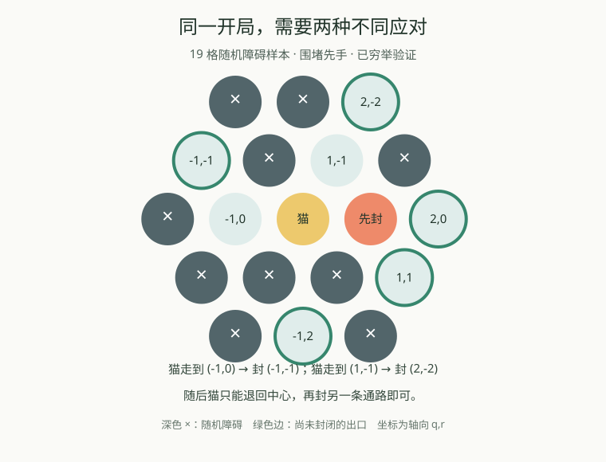
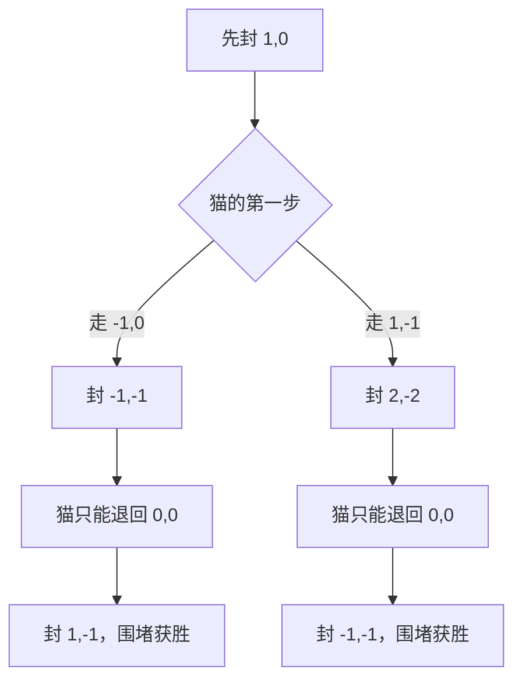

# 围堵小猫：从固定包围线到分支策略

研究与实验日期：2026-09-11。结论来自论文原文、当前规则下的穷举核对与本机实测。原型保存在 `research/`，尚未替换游戏 AI。

发布更新：后续版本已把分支求解器接入游戏，并增加随机开局筛选与新的对抗搜索。当前状态见 [更新与可玩性验证](../更新与可玩性验证.md)。以下保留研究阶段的原始结果，不应当作发布版本的运行状态。

## 本轮得到什么

1. 找到一个真实随机开局：**围堵方必胜，但任何预先固定的封堵序列都不能保证获胜**。因此原先只找固定封堵方案的方法确实不完整。
2. 实现证明数搜索 PNS，以及“PNS＋固定方案证明捷径”的混合方法，输出可以重新核验的分支策略。
3. 在 36 个普通随机样本上，纯 PNS 完成 22 个证明，混合方法和旧求解器各完成 25 个。新方法没有全面胜过旧方法；其目前明确的价值是能导出分支证明并独立检查。
4. 321 格、18% 随机障碍的三个样本，混合方法即使给 5 秒仍未完成证明。**通用大地图的稀疏开局尚未解决。**
5. 游戏默认已恢复普通随机散点。旧构造器保留为明确标注“可能预置包围线”的可选练习模式，其胜率不参与此次实验。

## 论文怎样影响了实现

最接近的模型是 Sabotage Games：一方移动，另一方不断删除图上的边或顶点。但原文删点变体保护目标点、由移动方先行，和本游戏有差别；一般图上的复杂性结果也不能直接当成六邻接棋盘的定理。[Löding 与 Rohde，2003，第 2、5 节](https://webdoc.sub.gwdg.de/ebook/serien/ah/AIB/2003-05.pdf)

实际采用的是 PNS 的 AND/OR 证明结构：证明围堵方获胜时，围堵回合找到一个有效行动就够；猫回合需要覆盖所有合法应对。证明数用于决定先探索哪个未决分支，而不是评估胜率。共享状态和内存消耗是这种方法的已知难点。[Kishimoto 等，2012，第 2、3、6 节](https://dke.maastrichtuniversity.nl/m.winands/documents/ICGA2012PNS.pdf)

其余关于 Angel、Nemesis、Cat Herding 和 Firefighter 的规则差异见上一级的 [论文调研与改进方向](../论文调研与改进方向.md)。没有把无限棋盘必胜、删边游戏算法或火焰同时扩散模型直接套成本游戏的有限地图判据。

## 一个可以复现的反例

地图是半径 2 的六角棋盘，共 19 格。使用原有普通散点生成器 `R.createGame`，障碍比例 55%，种子 `adaptive-0`，实际生成 10 个障碍；猫从 `(0,0)` 出发，围堵方先手。此例用于验证算法区别，不作为大型地图的平衡设计。



完整必胜策略如下，每个“猫走”节点已经列全当时的合法选择：



这里的第二个障碍必须响应猫的选择。更强的核对是：另一个穷举程序尝试所有合法的固定封堵序列，而不只尝试圆环或最小割候选，最终确认不存在对所有猫路线通用的固定序列。

证据：终局 minimax 参考程序访问 310 个状态后确认围堵必胜；固定序列穷举访问 50 个集合状态后排除全部固定方案；PNS 使用 123 个唯一状态找到证明，导出策略图有 10 个节点，独立检查通过。这里没有声称该地图是最小反例，也没有声称此策略抓猫步数最少。

- [可直接导入游戏的地图 JSON](adaptive-example-map.json)：导入后把新增障碍比例设为 **0%**，关闭构造练习模式，以保留这个确切局面。
- [原始状态、证书与核验结果](adaptive-example.json)
- [反例搜索程序](find-example.cjs) / [两个穷举参考程序](reference.cjs)

## 原型保证什么

`proof-search.cjs` 用“猫位置、障碍位集合、轮到谁”区分状态，合并完全相同的状态。每两次行动必然增加一个永久障碍，因此完整状态图无环；猫返回原位置不代表完整局面发生循环。

以围堵获胜为待证命题，OR 节点使用最小子证明数和子反证数之和，AND 节点反之。有限正数求和饱和至上限，只有终局或已证实分支才能产生零。共享后代可能让证明数重复计数，影响搜索效率，但不会把正数启发式值解释成胜负。

展开一个节点时保留**全部合法行动**；排序只影响顺序。预算在展开中途耗尽时，不提交部分子节点列表。零时间或节点不足均返回 `unknown`，不会把未检查的猫应对当作不存在。

证明输出支持双方：获胜方的回合保留一个动作，对方回合必须包含全部合法动作；所有叶子最终获胜。混合模式额外允许固定封堵方案作为已核验叶子，因此可以在不同猫分支使用不同方案。它不会通过调整开局障碍来帮助证明。

检查器从给定初始局面重新使用游戏的 `rules.js` 执行每一步，检查动作合法性、对手分支完整性、终局胜负、共享节点状态一致性及循环。它没有复用 PNS 的位集合移动和胜负计算；混合叶子的固定方案则交给已有全猫路径检查器 `verifyPlan` 复核。

## 随机地图实验

预先固定四张地图，三档障碍比例（18%、35%、55%），各用三个种子 `research-holdout-0..2`，共 36 局。所有开局直接由 `R.createGame` 生成，没有按胜负筛选，没有调用 `createCertified`，没有为某个算法补墙。该生成器会拒绝立即切断全部逃生路径的障碍，因此也不声称它在所有合法布局上均匀采样。

每次搜索名义预算 500 ms、节点上限 30,000；旧求解器深度放宽到 30 个单方行动层。纯 PNS 不使用固定方案捷径；混合方法与旧求解器都使用。旧程序统计访问次数，PNS 统计唯一状态，节点上限并非完全等价的工作量；时间存在本机波动，且搜索顺序固定。本表是小批次工程基线，不能据此宣布某算法普遍更快。

表格中的数字依次为 **围堵必胜 / 猫必胜 / 未判定**，不是 AI 对战胜率：

| 地图 | 格数 | 旧求解器 | 纯 PNS | 混合方法 |
| --- | ---: | ---: | ---: | ---: |
| 六角，半径 2 | 19 | 2 / 7 / 0 | 2 / 7 / 0 | 2 / 7 / 0 |
| 六角，半径 3 | 37 | 5 / 2 / 2 | 4 / 0 / 5 | 5 / 0 / 4 |
| 六角，半径 5 | 91 | 5 / 0 / 4 | 6 / 0 / 3 | 6 / 0 / 3 |
| 缺角岛屿，半径 10 | 321 | 4 / 0 / 5 | 3 / 0 / 6 | 5 / 0 / 4 |
| 合计 | 36 局 | 16 / 9 / 11 | 15 / 7 / 14 | 18 / 7 / 11 |

混合方法补出了旧方法未判定的部分围堵策略；旧方法在部分猫必胜局面上更有效。所有新原型返回的证书都通过独立检查；同一局凡双方方法都给出确定结果，结果一致。初始局面仅有 12 局被旧固定方案查找器直接识别为有解；未找到固定方案的其余局面不等于不存在固定方案，只有上述反例做了完整排除。

从障碍比例看，混合方法在 18% 的 12 局中只判定了三个 19 格棋盘为猫胜，其余九局未判定；55% 的 12 局全部判定，其中 11 局围堵胜。提高障碍密度可以明显改变这批样本的结构，但这不能证明某个比例适合公平双人游戏，更不能把高密度易题上的证明覆盖率当成 AI 棋力。

原始逐局结果、实际耗时、节点数、核验节点数、CPU 和 Node 版本保存在 [benchmark-results.json](benchmark-results.json)。

### 增加预算后的结果

对 37 格和 321 格的同一批 18% 障碍样本，混合方法提高至 5,000 ms、300,000 个唯一状态：

| 地图 / 种子末位 | 结果 | 唯一状态 | 耗时 ms | 停止原因 |
| --- | --- | ---: | ---: | --- |
| 37 格 / 0 | 未判定 | 300,000 | 2,616 | 节点上限 |
| 37 格 / 1 | 猫必胜 | 102,047 | 817 | 证明完成 |
| 37 格 / 2 | 猫必胜 | 166,290 | 1,275 | 证明完成 |
| 321 格 / 0 | 未判定 | 113,453 | 5,000 | 时间上限 |
| 321 格 / 1 | 未判定 | 126,261 | 5,000 | 时间上限 |
| 321 格 / 2 | 未判定 | 95,313 | 5,000 | 时间上限 |

两个猫方策略的证书分别包含 16,716 和 20,101 个核验节点，均检查通过。这说明棋盘看起来只有几十格也可能需要很大的“应对任何封堵”证明。扩展实验见 [scaling-results.json](scaling-results.json)。耗时是本次运行测量值，不承诺每次复现相同。

## 实现验证与复现

新增测试覆盖：256 个七格棋盘状态（全部障碍子集、双方轮次），以及 60 个十九格随机状态，纯 PNS 与终局穷举一致；另外 60 个随机状态验证混合方法。它们都是有限测试集，不代替算法正确性的完整数学证明。

额外检查固定序列反例、缺失猫分支、非法落点、假终局、证书循环、缺失节点、伪造固定方案和展开中途耗尽预算。全项目测试请运行：

```powershell
npm test
node research/find-example.cjs
node research/render-example.cjs
node research/benchmark.cjs
node research/scaling.cjs
```

基准命令会重写对应研究结果 JSON；不同负载下，临界预算样本的已判定数量可能变化。原型和脚本使用 Node 内置模块，不需要安装依赖。

## 对后续游戏改进的判断

**先分清求解与对弈。**求解器回答双方最优应对时谁必胜；实战 AI 还需要在未判定时选出足够好的动作。当前研究完成前者的可检查分支原型，没有完成大地图强 AI，也没有进行新 AI 胜率测试。

下一步值得验证的是：用深度优先证明数搜索降低内存压力，对猫方和围堵方分别设置搜索目标与动作排序，并研究可证明安全的行动合并。它们目前是研究假设，不是已取得的加速；特别是不能仅凭“远处障碍看起来没用”就删去合法应对后宣称必胜。

随机地图应坚持先按约定规则生成，再标记“已证明某方获胜”或“未判定”。如果要专门提供围堵解谜局，应在普通生成样本中筛选可证明的局面，并明确这会改变被接受地图的分布。对于竞技双人模式，可解性只决定最优胜方；是否有趣、容错是否合适，还需要后续跨对手与真人体验评估。

目前选择保留实验原型，避免把未改善的稀疏大图算法直接替换进游戏，再声称问题已经解决。
